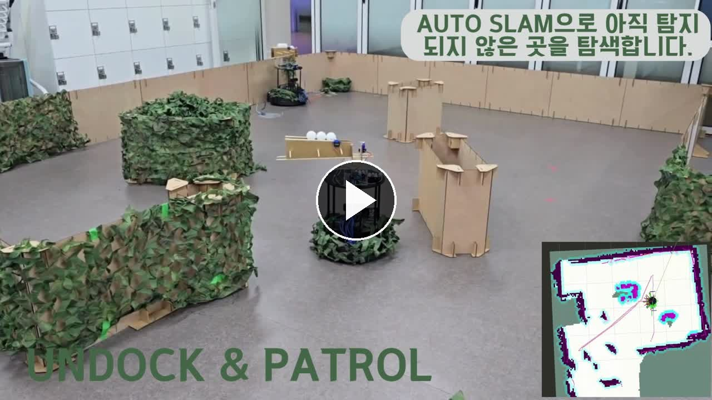

# 🤖 SLAM 기반 자율 순찰·표적 대응 무인 전투로봇

TurtleBot4가 미지의 환경을 SLAM을 통해 실시간 매핑하고 자율 순찰하며 YOLO로 상대 로봇을 탐지한 뒤 운용자 승인에 따라 조준·추적·접근·발사를 수행하는 ROS 2 기반 자율 로봇 시스템입니다.

## 📑 목차

- [프로젝트 개요](#-프로젝트-개요)
- [시연 자료](#-시연-자료)
- [프로젝트 목표](#-프로젝트-목표)
- [담당 역할](#-담당-역할)
- [핵심 기능](#-핵심-기능)
- [시스템 동작 흐름](#-시스템-동작-흐름)
- [시스템 아키텍처](#️-시스템-아키텍처)
- [주요 ROS 2 노드 및 인터페이스](#-주요-ros-2-노드-및-인터페이스)
- [기술적 고민과 해결](#-기술적-고민과-해결)
- [저장소 구조](#-저장소-구조)
- [설치 및 실행](#-설치-및-실행)
- [구현 결과](#-구현-결과)
- [안전 고려사항](#️-안전-고려사항)
- [제한 사항](#️-제한-사항)
- [개선 방향](#-개선-방향)
- [라이선스](#-라이선스)

---

## 📌 프로젝트 개요

SOCAMACA는 자율주행 로봇, 객체 탐지, 웹 관제 화면과 Arduino 슈터를 하나의 ROS 2 시스템으로 통합한 프로젝트입니다. 로봇은 SLAM과 Nav2를 기반으로 새로운 환경을 순찰하며 적을 발견하면 순찰을 일시 중단하고 영상 중심 오차에 따라 방향을 정렬합니다. 발사는 자동으로 실행하지 않고 운영자가 웹 UI에서 승인한 경우에만 진행합니다.

| 항목 | 내용 |
| --- | --- |
| 플랫폼 | TurtleBot4 |
| 운영체제 | Ubuntu 22.04 LTS |
| 미들웨어 | ROS 2 Humble |
| 자율주행 | SLAM Toolbox, Nav2, explore_lite |
| 객체 탐지 | YOLO, OpenCV, OAK-D 또는 스마트폰 카메라 |
| 웹 | React, TypeScript, FastAPI, rosbridge |
| 하드웨어 제어 | Arduino, ROS 2 Python node |

---

## 🎬 시연 자료

<p align="center">
  <a href="docs/media/socamaca-demo.mp4">
    
  </a>
</p>

<p align="center"><strong>이미지를 클릭하면 시연 영상이 재생됩니다.</strong></p>

---

## 🎯 프로젝트 목표

카메라 탐지, 자율주행, 로봇 추적, 운영자 승인과 발사 제어가 서로 다른 프로세스에서 동작하는 환경에서 다음 문제를 해결하는 것을 목표로 했습니다.

- 순찰 중 상대 로봇을 발견하면 탐색을 중단하고 조준 상태로 전환
- 영상 좌표와 추정 거리를 로봇의 회전·접근 명령으로 변환
- Nav2, 조준 노드와 접근 노드의 속도 명령 충돌 방지
- 오탐이나 잘못된 상태에서 발사되지 않도록 운영자 승인 절차 적용
- 로봇, 웹 UI, 심판 시스템과 Arduino 사이의 상태 동기화

---

## 👤 담당 역할

ROS 2와 SLAM·Nav2를 활용한 TurtleBot4 자율 순찰 시스템과 적 발견 이후의 조준·추적·접근 이동 제어 로직을 설계·구현하고, YOLO 탐지 결과를 상태 머신과 연동했습니다.

- Nav2 및 explore_lite 기반 자율 순찰과 복귀 동작 구성
- 탐지 결과의 화면 중심 오차를 이용한 P 제어 기반 조준 로직 구현
- 상대 로봇 방향과 추정 거리를 결합한 접근 제어 구현
- 순찰, 조준, 쿨다운, 추적, 복귀를 관리하는 ROS 2 상태 머신 구현
- 상태별 `/cmd_vel` 발행 주체 분리 및 신호 유실 시 정지 처리

---

## ✨ 핵심 기능

### 1. SLAM·Nav2 기반 자율 순찰

TurtleBot4 Navigation을 실행하고 explore_lite로 미탐색 영역을 순찰합니다. 일정 시간 이동 진전이 없으면 explore_lite를 일시 정지하고, `NavigateThroughPoses`를 이용한 고정 웨이포인트 순찰로 전환합니다. 미션 종료 또는 로봇 비활성화 조건에서는 `NavigateToPose`로 시작 위치에 복귀합니다.

### 2. YOLO 기반 상대 로봇 탐지

OAK-D 또는 스마트폰 카메라 영상을 YOLO로 추론해 탐지 bounding box, 영상 중심 대비 좌우 오차, 추정 거리와 웹 UI용 압축 영상을 발행합니다. 스마트폰 카메라 입력은 최신 프레임만 유지하는 캡처·추론 분리 구조를 사용해 느린 추론으로 인한 프레임 누적을 방지했습니다.

### 3. 상태 기반 조준·접근 제어

조준 단계에서는 화면 중심 오차에 P 제어, EMA 필터와 슬루레이트 제한을 적용해 각속도를 계산합니다. 접근 단계에서는 회전과 전진 속도를 하나의 `Twist` 메시지로 결합해 발행하며, 목표 거리 이내에 도달하거나 탐지 신호가 유실되면 정지 후 순찰 상태로 복귀합니다.

### 4. 운영자 승인 기반 발사

로봇의 정렬이 완료돼도 즉시 발사하지 않습니다. 팀 운영 UI에서 승인 메시지가 수신되고 탄약 및 재장전 조건까지 만족한 경우에만 `fire_ready`를 발행합니다. Arduino 슈터 노드는 이 신호를 받아 발사를 수행하고 완료 상태를 ROS 2로 반환합니다.

### 5. 팀·심판용 웹 인터페이스

- 팀 UI: 카메라 영상, 탐지 박스, HP, 배터리, 탄약과 미션 상태 표시
- 운영자 UI: 정렬 상태 확인 및 발사 승인
- 심판 UI: 양 팀 상태, 경기 상태와 심판 카메라 탐지 결과 표시
- FastAPI 백엔드: 실제 rosbridge와 같은 메시지 형식을 사용하는 로컬 모의 실행 지원

---

## 🔄 시스템 동작 흐름

```text
PATROL
  │ 적 탐지
  ▼
WAIT_COMMAND ── 적 유실 ────────────────> PATROL
  │ 정렬 완료 + 운영자 승인
  ▼
FIRE 요청 ── shoot_complete 수신
  ▼
COOLDOWN
  ├─ 상대 HP 2~3, 15초 경과 ───────────> PATROL
  └─ 상대 HP 1
       ▼
     TRACK ── 목표 거리 도달/신호 유실 ─> PATROL

어느 상태에서든 내 HP가 0이거나 상대 HP가 0이면 RETURN
```

내부 제어 상태는 `PATROL`, `WAIT_COMMAND`, `COOLDOWN`, `TRACK`, `RETURN`으로 관리하며, 웹 UI에는 `IDLE`, `CHASE`, `AIM`, `WAIT_APPROVAL`, `FIRE`, `RETURN`, `DISABLED` 상태로 변환해 전달합니다. 자세한 전이 조건은 [상태 머신 문서](docs/state-machine.md)에서 확인할 수 있습니다.

---

## 🏗️ 시스템 아키텍처

<p align="center">
  
</p>

상태에 따라 속도 명령 발행 주체를 분리합니다.

| 상태 | 이동 제어 주체 | 동작 |
| --- | --- | --- |
| `PATROL`, `COOLDOWN` | Nav2 / explore_lite | 자율 순찰 |
| `WAIT_COMMAND` | `azimuth_tracker` | 제자리 조준 회전 |
| `TRACK` | `target_nav` | 회전과 전진을 결합한 접근 |
| `RETURN` | Nav2 | 시작 위치 복귀 |

전체 구성은 [아키텍처 문서](docs/architecture.md)를 참고하세요.

---

## 📡 주요 ROS 2 노드 및 인터페이스

| 노드 | 역할 |
| --- | --- |
| `mission_manager` | 미션 상태 전환, 순찰 제어, 발사 조건과 복귀 관리 |
| `azimuth` | 영상 중심 오차 기반 조준 회전 |
| `target` | 상대 방향·거리 기반 접근 제어 |
| `random_patrol` | explore_lite 정체 감지 및 웨이포인트 대체 순찰 |
| `phone_cam_detector` | 스마트폰 카메라 기반 YOLO 탐지 |
| `bbox4` | OAK-D 기반 YOLO 탐지 |
| `arduino_shooter_node` | 발사 요청과 Arduino 슈터 연동 |

| 토픽/액션 | 타입 | 용도 |
| --- | --- | --- |
| `aim/set_ori` | `std_msgs/Float32` | 영상 중심 대비 좌우 오차 |
| `enemy_distance` | `std_msgs/Float32` | 상대 로봇 추정 거리 |
| `robot_mode` | `std_msgs/String` | 내부 미션 상태 공유 |
| `cmd_vel` | `geometry_msgs/Twist` | 회전·접근 속도 명령 |
| `shoot_approval` | `std_msgs/Bool` | 운영자 발사 승인 |
| `fire_ready` | `std_msgs/Bool` | 슈터 발사 준비 요청 |
| `shoot_complete` | `std_msgs/Bool` | 발사 완료 알림 |
| `status` | `socamaca_msgs/TeamStatus` | UI용 로봇 상태 |
| `navigate_to_pose` | `nav2_msgs/NavigateToPose` | 시작 위치 복귀 |

주요 토픽은 상대 경로로 정의되어 실행 시 네임스페이스를 지정하면 여러 로봇에 같은 코드를 적용할 수 있습니다. 전체 목록은 [ROS 인터페이스 문서](docs/ros-interfaces.md)를 참고하세요.

---

## 🧠 기술적 고민과 해결

### Nav2와 직접 속도 제어의 충돌

Nav2, 조준 노드와 접근 노드가 동시에 같은 `cmd_vel` 토픽을 발행하면 명령이 서로 덮어써 주행이 끊기거나 불안정해질 수 있습니다. 상태 머신이 각 단계의 이동 제어 주체를 결정하도록 구성하고, 비활성 상태의 제어 노드는 0 속도를 반복 발행하는 대신 발행 자체를 중단하도록 구현했습니다.

### 탐지 흔들림에 따른 조준 진동

YOLO bounding box가 프레임마다 흔들리면 로봇의 회전 방향도 빠르게 바뀔 수 있습니다. 중앙 데드밴드, EMA 저역통과 필터와 각속도 슬루레이트 제한을 적용해 작은 오차를 무시하고 급격한 회전 변화를 완화했습니다.

### 느린 추론으로 인한 영상 지연 누적

카메라 프레임을 큐에 계속 저장하면 추론 결과가 현재 장면보다 늦게 출력됩니다. 캡처 스레드가 최신 프레임 하나만 보관하고 추론 스레드가 이를 가져가는 구조로 오래된 프레임이 누적되지 않도록 했습니다.

### 늦게 실행된 노드의 상태 불일치

제어 노드가 `mission_manager`보다 늦게 실행되면 현재 상태를 받기 전까지 잘못된 기본 상태로 동작할 수 있습니다. `robot_mode`에 `TRANSIENT_LOCAL` QoS를 적용해 새 구독자가 마지막 상태를 즉시 전달받도록 했습니다.

### 통신 및 탐지 신호 유실

조준·접근 제어는 마지막 메시지 수신 시간을 검사합니다. 제한 시간 동안 방향 또는 거리 정보가 들어오지 않으면 정지 명령을 발행하고 해당 동작을 종료해 이전 속도 명령이 계속 유지되지 않도록 했습니다.

---

## 📁 저장소 구조

```text
ros2/
  amr_ws/tracking/                 상태 머신·조준·추적·순찰 노드
  perception_ws/src/
    socamaca_msgs/                 커스텀 ROS 2 메시지
    yolo_detector/                 스마트폰/OAK-D YOLO 탐지 노드
web/
  frontend-team-pc/                팀 운영 UI
  frontend-judge-pc/               심판 UI
  backend/                         FastAPI 백엔드 및 모의 rosbridge
  judge-vision/                    심판 카메라 비전 모듈
hardware/arduino_shooter_node.py   Arduino 슈터 ROS 2 노드
experiments/                       탐지 실험 코드
scripts/                           전체 실행·종료 스크립트
docs/                              설계·상태·인터페이스 문서
```

---

## 🚀 설치 및 실행

아래 명령은 저장소 루트를 기준으로 실행합니다.

### 저장소 내려받기

```bash
git clone https://github.com/zhyeok-00/DooSan_Robotics-Turtlebot_Project.git
cd DooSan_Robotics-Turtlebot_Project
```

### 사전 준비

- Ubuntu 22.04 LTS, ROS 2 Humble
- TurtleBot4 표준 워크스페이스
- `explore_lite`, rosbridge, ffmpeg
- Node.js 18 이상
- CUDA 지원 GPU 권장

```bash
sudo apt install ros-humble-rosbridge-server ffmpeg
```

### ROS 2 빌드

```bash
cd ros2/perception_ws
colcon build --symlink-install
source install/setup.bash

cd ../amr_ws
source ../perception_ws/install/setup.bash
colcon build --symlink-install --packages-select tracking
source install/setup.bash
cd ../..
```

### Python 및 프런트엔드 설치

```bash
pip install ultralytics opencv-python
pip install -r web/backend/requirements.txt
pip install -r web/judge-vision/requirements.txt
pip install -r experiments/requirements.txt

cd web/frontend-team-pc && npm install
cd ../frontend-judge-pc && npm install
cd ../..
```

### 환경 설정

실제 IP, 계정, 경로와 비밀번호는 저장소에 커밋하지 않습니다.

```bash
cp .env.example .env
cp web/frontend-team-pc/.env.example web/frontend-team-pc/.env
cp web/frontend-judge-pc/.env.example web/frontend-judge-pc/.env
```

루트 `.env`에서 현재 환경에 맞게 설정합니다.

- `TB4_SETUP`: TurtleBot4 워크스페이스 setup 파일
- `ROBOT_HOST`, `ROBOT_USER`: SSH 대상 로봇
- `ROBOT_WORKSPACE_SETUP`: 로봇의 슈터 워크스페이스 setup 파일
- `ROBOT_NAMESPACE`: ROS 2 로봇 네임스페이스

원격 실행은 비밀번호를 코드에 저장하지 않고 SSH 키 인증을 사용합니다.

### 전체 시스템 실행과 종료

```bash
./scripts/start_all.sh
./scripts/stop_all.sh
```

### 주요 노드 개별 실행

```bash
ros2 run yolo_detector phone_cam_detector --ros-args -r __ns:=/robot4
ros2 run yolo_detector bbox4 --ros-args -r __ns:=/robot4
ros2 run tracking mission_manager --ros-args -r __ns:=/robot4
ros2 run tracking azimuth --ros-args -r __ns:=/robot4
ros2 run tracking target --ros-args -r __ns:=/robot4
```

모델 가중치는 재배포 권한 확인이 필요하므로 공개 저장소에 포함하지 않습니다. 학습한 `y11s_my_best.pt` 또는 호환되는 모델을 준비한 뒤 ROS 파라미터로 경로를 지정합니다.

```bash
ros2 run yolo_detector phone_cam_detector --ros-args \
  -p model_path:=/path/to/model.pt -r __ns:=/robot4
```

---

## ✅ 구현 결과

프로젝트 진행 당시 TurtleBot4 실기 환경에서 자율 순찰, YOLO 기반 상대 로봇 탐지, 조준·접근 제어, 운영자 승인과 Arduino 슈터 연동까지 전체 시나리오의 동작을 확인했습니다.

---

## 🛡️ 안전 고려사항

- 발사는 로봇 정렬과 운영자 승인이 모두 확인된 경우에만 요청합니다.
- 탄약이 없거나 재장전 중이면 승인 메시지가 수신돼도 발사를 요청하지 않습니다.
- 탐지·거리 신호가 유실되면 로봇을 정지하고 접근 동작을 종료합니다.
- 실제 슈터를 연결하기 전에는 발사체를 제거한 상태에서 통신과 상태 전환을 먼저 확인해야 합니다.

자세한 내용은 [안전 문서](docs/safety.md)를 참고하세요.

---

## ⚠️ 제한 사항

- 전체 시스템 재현에는 TurtleBot4, 카메라와 Arduino 장치가 필요합니다.
- 네트워크 상태에 따라 영상 및 TF 데이터 전송이 지연될 수 있습니다.
- 스마트폰 카메라의 거리는 bounding box 높이에 기반한 추정값이므로 대상 자세와 카메라 보정 상태에 영향을 받습니다.
- 모델 가중치의 크기와 재배포 조건은 공개 저장소 게시 전에 별도로 확인해야 합니다.

---

## 🔭 개선 방향

- 카메라 내부 파라미터와 깊이 정보를 반영한 거리·각도 추정
- 탐지 추적 필터를 적용한 일시적 오탐 및 가림 대응
- Gazebo 또는 Isaac Sim 기반 통합 재현 환경 구축
- rosbag 입력을 활용한 탐지·제어 회귀 테스트 자동화
- 실제 하드웨어를 연결하는 통합 테스트 절차 문서화

---

## 📄 라이선스

소스 코드는 저장소의 [LICENSE](LICENSE)를 따릅니다. YOLO 모델 가중치와 외부 데이터의 배포 조건은 [모델 자산 문서](docs/model-assets.md)를 별도로 확인하세요.
