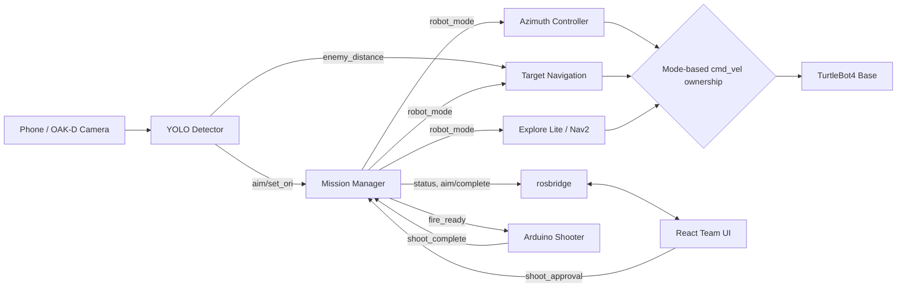
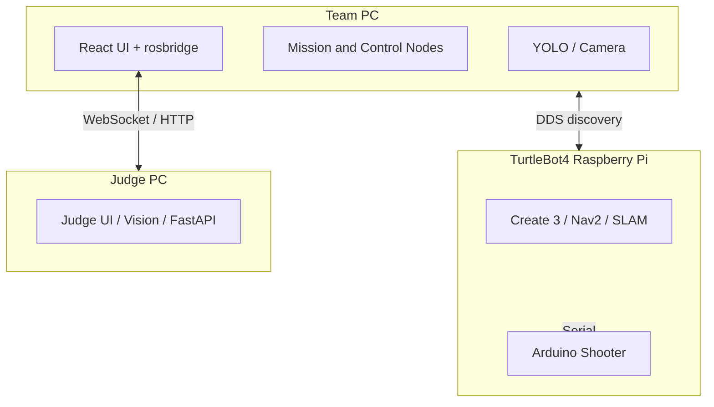

# SOCAMACA 시스템 아키텍처

## 전체 데이터 흐름

`cmd_vel`은 별도 소프트웨어 mux가 아니라 `robot_mode`에 따른 상호 배타적 발행으로 소유권을 나눕니다.

| 모드 | `cmd_vel` 소유자 | 동작 |
|---|---|---|
| `PATROL`, `COOLDOWN`, `RETURN` | Nav2 / explore_lite | 순찰 또는 복귀 |
| `WAIT_COMMAND` | `azimuth_tracker` | 제자리 조준 회전 |
| `TRACK` | `target_nav` | 목표 방향 회전 및 제한 속도 접근 |

## 배포 구성

환경별 IP, ROS workspace 경로와 계정은 저장소가 아닌 루트 `.env`에서 주입합니다.
