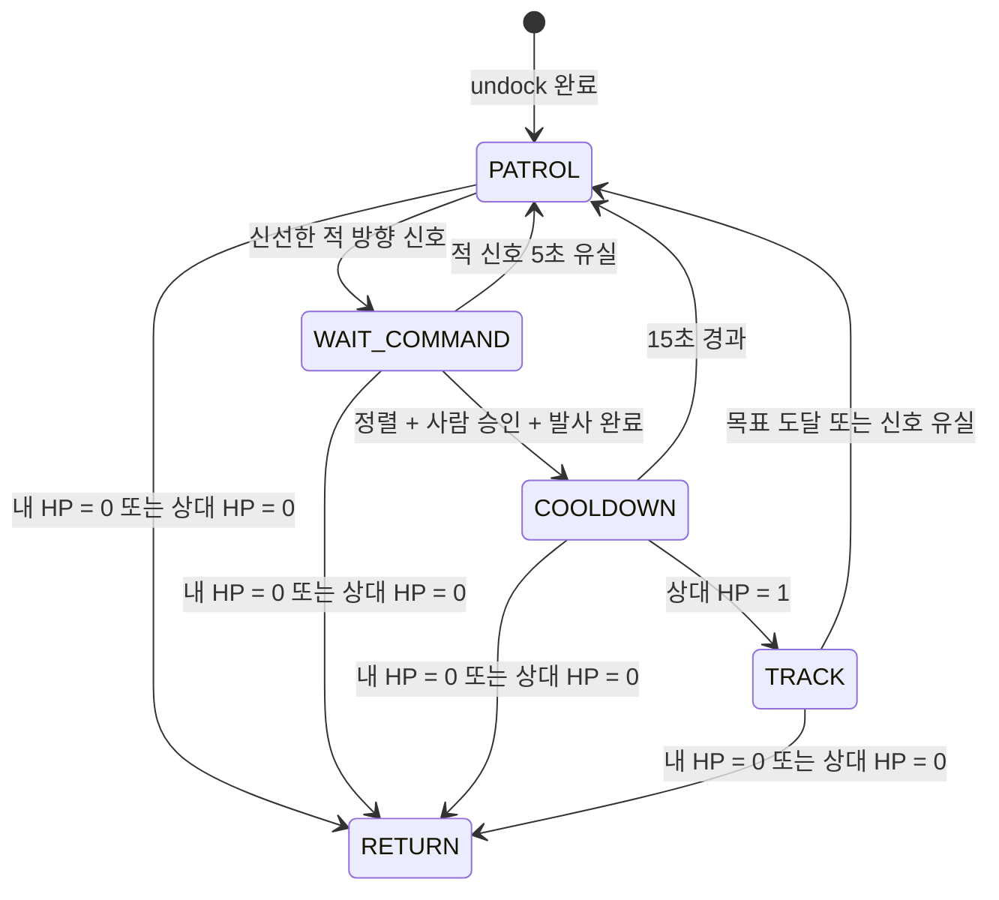

# 미션 상태 전이

## 상태별 불변조건

| 상태 | 불변조건 |
|---|---|
| `PATROL` | 조준·추적 노드는 `cmd_vel`을 발행하지 않음 |
| `WAIT_COMMAND` | Nav2 순찰 정지, 정렬 및 사람 승인 전 발사 금지 |
| `COOLDOWN` | 재조준·재발사 금지, 순찰만 수행 |
| `TRACK` | 새 방향과 거리 신호가 모두 수신되기 전 정지 |
| `RETURN` | 전투 동작 중지, 홈 위치 복귀 |

HP 0 규칙은 일반 전이보다 우선하며 모든 활성 상태에서 `RETURN`으로 전환합니다.
